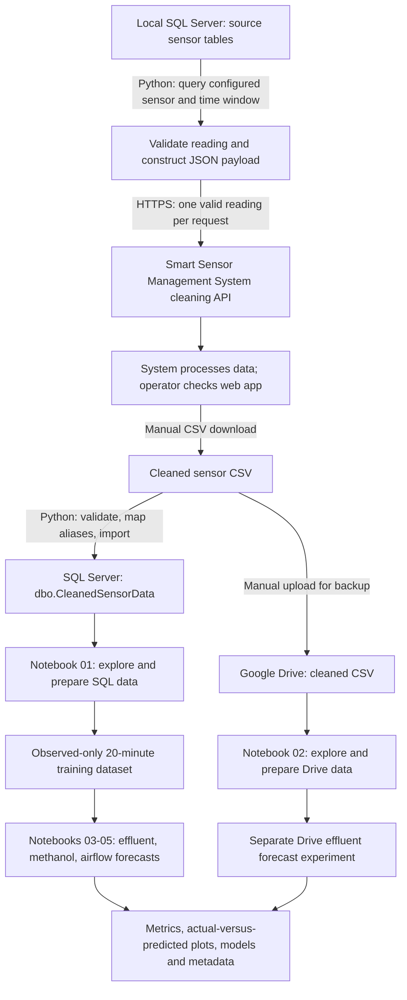
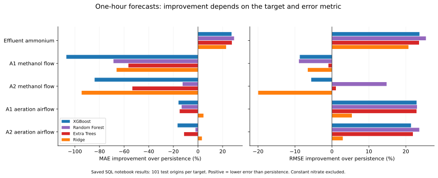
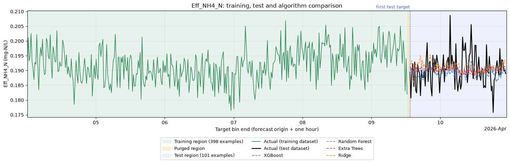
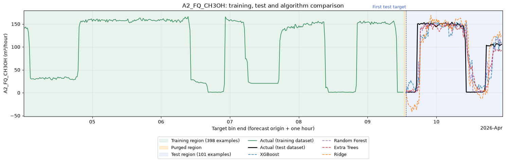
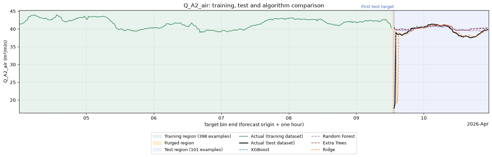

# AO-MBR ETL Pipeline and Jupyter Model Evaluation

Report date: 19 October 2026. Results below describe the April 2026 data recorded in the saved notebooks.

The workflow moves historical sensor readings from a local SQL Server database through the **Smart Sensor Management System** cleaning service, then returns the downloaded results to SQL Server and backs up the CSV on Google Drive. Jupyter notebooks provide a second stage of data inspection, missing-value preparation, forecasting, and evaluation. API submission and database import are implemented in Python; checking cleaning completion, downloading the cleaned CSV, and uploading the backup are manual operations.

The saved experiments demonstrate that this workflow can produce datasets and compare forecasting methods. Performance depends on the target and the error measure: some fitted models improve on persistence, while methanol forecasts often favor persistence. The current evaluation is preliminary because it uses a short period selected for data completeness.

## 1. End-to-end workflow

The **cleaning API** processes sensor measurements. The forecasting algorithms are trained locally in Jupyter. The active submission workflow does not call a prediction service or automatically retrieve cleaned results.

| Stage | Processing and responsibility | Result |
|---|---|---|
| Extract | Python connects to local SQL Server and queries one configured sensor within the selected interval. | Timestamped source readings |
| Submit | Python validates each reading, maps its sensor tag, and sends an authenticated API request. | Readings submitted to the cleaning system |
| Clean and export | The external system cleans the submitted data; the operator checks the web app and downloads its CSV. | Cleaned export file |
| Load | Python validates the downloaded file and imports it into a separate SQL table. | Queryable cleaned sensor data |
| Back up | The operator uploads the CSV to Google Drive. | Backup copy and alternate notebook input |
| Prepare | Jupyter examines timestamps, distributions, gaps, sensor behavior, and model-input coverage. | Audited minute-level data and observed-only aggregates |
| Train and evaluate | Jupyter creates future labels, splits chronologically, fits several algorithms, and compares predictions. | Evaluation tables, plots, fitted models, and reproducibility records |

### Extraction, submission, and loading controls

The source mapping comes from [config/sensors.py](../config/sensors.py). The extractor combines `DATA_DATE` and `DATA_TIME` into the observation timestamp and orders readings by timestamp and `DATA_ID`. The configured extraction window is **24 March 2026 00:00 through 23 April 2026 13:00**, inclusive. This is broader than the seven-day window subsequently selected for SQL model evaluation.

The active [submission workflow](../src/pipeline.py) sends `fullTagName`, `datetime`, and `value`; the [API client](../src/api_client.py) adds authentication from environment settings. Missing, non-numeric, and non-finite values are skipped. A dry run counts extracted readings without HTTP requests. Submission stops on the first HTTP or transport failure, with explicit resume options and no automatic retries.

An HTTP 2xx response confirms HTTP success only. The client does not validate application-level acceptance or cleaning completion, so the operator's web-app check remains part of the workflow. The repository does not establish the service's internal cleaning rules or quantify its effect through a before/after quality comparison.

The [CSV importer](../src/csv_loader.py) maps full sensor tags to SQL aliases through [Sensor_Configurations.xlsx](../Sensor_Configurations.xlsx). It validates the complete CSV before connecting to SQL Server, preserves blank readings as SQL NULL, and rejects malformed values and duplicate timestamps within the file. Its default destination, `dbo.CleanedSensorData`, has a timestamp primary key when created by the importer. Overlapping imports therefore fail on that key rather than overwrite existing rows. Inserts run within one transaction, and a failed import rolls back. Configured raw source tables are protected from cleaned-data imports.

## 2. Notebook organization and exploration

| Notebook | Purpose | Input |
|---|---|---|
| [01: Explore cleaned SQL data](../notebooks/01_explore_clean_data.ipynb) | Inspect timestamps, null counts, descriptive statistics, and sensor timelines; select a seven-day candidate and export prepared data. | `dbo.CleanedSensorData` |
| [02: Explore Google Drive CSV](../notebooks/02_explore_google_drive_csv.ipynb) | Inspect the backup independently of SQL Server, visualize sensors with bilingual labels, fill eligible feature gaps, and run a separate effluent comparison. | Downloaded Drive CSV |
| [03: Train effluent models](../notebooks/03_train_effluent_nh3_no3.ipynb) | Forecast effluent ammonium and nitrate one hour ahead. | SQL-derived 20-minute means and observation counts |
| [04: Train methanol models](../notebooks/04_train_ch3oh_dosing.ipynb) | Forecast recorded A1 and A2 methanol dosing flow one hour ahead. | Same SQL-derived aggregate |
| [05: Train airflow models](../notebooks/05_train_aeration_flow.ipynb) | Forecast recorded A1 and A2 aeration airflow one hour ahead. | Same SQL-derived aggregate |

Exploration checks the loaded shape, date range, duplicate timestamps, numeric summaries, missing readings per sensor, and readings over time. Null-count charts make missingness visible before model preparation. Sensor timelines help distinguish isolated gaps, recurring gaps, flat signals, and changes in operating conditions. Notebook 02 also plots A2 aerobic MLSS alongside DO, ORP, pH, and airflow to examine surrounding measurements on a shared time axis.

The effluent task named `eff_nh3_n` actually uses the configured sensor alias **`Eff_NH4_N`**, identified as effluent ammonium nitrogen. This report retains the measured target name to avoid treating the NH3 task label and NH4 sensor label as interchangeable.

## 3. Data preparation and missing values

### Conservative minute-level filling

Missing values remain visible during initial exploration. The preparation cells interpolate only short interior feature gaps: at most **three missing rows**, with observed endpoints no more than **four minutes apart**. Flow features also require both endpoints to have the same zero, positive, or negative state. Long gaps and entirely unobserved signals remain missing. All six configured forecast targets remain observed-only.

The notebooks retain an imputation mask and a per-column summary so estimated cells can be distinguished from measurements. Time interpolation uses a later observation, so it is retrospective: if used for model inputs, it must respect chronological split boundaries and the time at which the right endpoint becomes available. The SQL forecasting experiments below avoid interpolated inputs entirely by aggregating raw observations.

### SQL training candidate

Notebook 01 searched **33,080 seven-day intervals** in **43,139 source rows**, ranking candidates by remaining missingness after the conservative filling policy. It selected **3 April 2026 22:45 inclusive to 10 April 2026 22:45 exclusive**. Source timestamps are retained without timezone conversion.

| Preparation measure | Saved result |
|---|---:|
| Selected minute-level shape | 10,080 rows × 30 sensors |
| Absent timestamps in selected grid | 0 |
| Missing sensor cells before filling | 77,535 |
| Feature cells filled | 858 |
| Missing cells after filling | 76,677 (25.3562%) |
| Observed-only 20-minute shape | 504 rows × 30 sensors |
| Missing cells in 20-minute aggregate | 0 |
| Minimum actual readings per sensor per aggregate bin | 5 |

Minute-level filling improves coverage but leaves the effluent configurations with zero complete contemporaneous input-and-target rows. The complete model candidate therefore uses **20-minute means of raw observations**, accompanied by counts of contributing observations. Despite the filename `data_filled_20min.csv`, these means contain no interpolated values.

Bins use their **end time** as the availability timestamp. For example, observations in `[22:45, 23:05)` form the mean available at 23:05. This prevents a completed interval's mean from being treated as available at its start. Aggregation resolves input completeness in this selected period, but smooths minute-level variation; its evaluation measures prediction of interval averages.

### Google Drive preparation

The saved Drive run requested **2 April 2026 13:40 to 7 April 2026 13:40**, but its source contains only **1,440 minute rows on 4 April**. Preparation filled **110 feature cells**, retained those 1,440 timestamps, and removed **5,760 completely blank timestamps** from the minute-level export. The requested five-day range therefore does not represent five days of observations.

The Drive forecasting section builds raw observed 20-minute means separately from the filled export. It reports **360 requested bins, of which 72 are nonempty**. Remaining feature gaps are handled by median-imputation pipelines fitted on training data, with missingness indicators; future target labels remain observed-only. These results form a separate experiment from the seven-day SQL results.

## 4. Forecast design and evaluation

Each model predicts the target interval mean ending **one hour after the forecast origin**. Inputs consist of configured current-bin sensor means plus the current target value as an autoregressive feature. Persistence predicts that the target one hour later will equal its current observed mean.

| Task | Target | Total model inputs | Input selection |
|---|---|---:|---|
| Effluent ammonium | `Eff_NH4_N` | 17 | 16 configured features plus current ammonium |
| Effluent nitrate | `Eff_NO3_N` | 22 | 21 configured features plus current nitrate |
| A1 methanol | `A1_FQ_CH3OH` | 11 | Workbook-checked inputs, including current dosing flow once |
| A2 methanol | `A2_FQ_CH3OH` | 11 | Workbook-checked inputs, including current dosing flow once |
| A1 airflow | `Q_A1_air` | 10 | Nine workbook-checked external inputs plus current airflow |
| A2 airflow | `Q_A2_air` | 11 | Ten workbook-checked external inputs plus current airflow |

The methanol and airflow notebooks audit workbook selections against application configuration. Current airflow is separately identified as an additional autoregressive input, rather than a workbook-checked input.

Four supervised methods are compared: **XGBoost**, **Random Forest**, **Extra Trees**, and **Ridge regression**. Ridge uses training-fitted standardization. Each algorithm receives the same examples and future targets within its task. Parameters are fixed rather than tuned on test performance.

For each SQL task, 504 aggregate bins produce **501 one-hour input/label pairs**. An initial chronological 80/20 split gives 400 earlier origins and 101 later test origins. Two earlier origins are purged because their labels would become available after the first test forecast origin, leaving **398 training, 2 purged, and 101 test examples**.

| Split detail | Saved SQL experiment |
|---|---|
| Training forecast origins | 3 April 23:05 to 9 April 11:25 |
| Last training label available | 9 April 12:25 |
| Test forecast origins | 9 April 12:25 to 10 April 21:45 |
| Test target bin ends | 9 April 13:25 to 10 April 22:45 |

All times in this table are in 2026 and follow database time. A training label available exactly at the first test origin is permitted. Evaluation uses newly available measurements at each successive origin; it represents rolling one-hour forecasts with a fixed trained model.

The notebooks calculate MAE, RMSE, bias, R², and improvement over persistence. MAE measures typical absolute error, RMSE gives larger errors more weight, and bias is the mean of prediction minus observation. Negative R² means squared error exceeds that of the constant test-set mean reference; that reference is descriptive and is not an operational forecast. Improvement is `100 × (1 − model error / persistence error)`, so positive values indicate lower error than persistence. R² is undefined for a constant target, and baseline improvement is undefined when persistence error is zero.

## 5. Saved SQL evaluation results

All tables below use the same **101 held-out origins per target**. Values retain the six-decimal precision displayed in the notebooks. Nitrogen errors use mg-N/L; methanol and airflow units follow workbook labels and still require confirmation against instrument scaling.

*Figure 1. Positive bars indicate lower error than persistence. Nitrate is excluded because its constant target gives zero baseline error.*

### Effluent ammonium and nitrate

| Algorithm | Ammonium MAE (mg-N/L) | Ammonium RMSE (mg-N/L) | R² |
|---|---:|---:|---:|
| XGBoost | 0.004171 | 0.005532 | -0.064584 |
| Random Forest | **0.004053** | **0.005405** | -0.016305 |
| Extra Trees | 0.004155 | 0.005540 | -0.067760 |
| Ridge | 0.004424 | 0.005747 | -0.149082 |
| Persistence | 0.005735 | 0.007248 | -0.827895 |

Random Forest has the lowest ammonium MAE and RMSE, improving on persistence by **29.33%** and **25.43%**, respectively. Every fitted model still has negative R², and the differences between algorithms are small. This supports further evaluation across additional periods rather than a claim of reliable operational accuracy.

Nitrate is constant at **5.0 mg-N/L** in the selected source. All four algorithms and persistence achieve **zero MAE and RMSE**. R² and improvement over persistence are undefined. This experiment cannot evaluate the ability to forecast changing nitrate concentrations.

*Figure 2. Saved notebook 03 comparison. Green shows training observations, amber the purged region, and blue the test region. Predictions appear only in the test region and use future target bin-end timestamps.*

### Methanol dosing flow

| Stream | Algorithm | MAE (m³/hour) | RMSE (m³/hour) | R² |
|---|---|---:|---:|---:|
| A1 | XGBoost | 24.233810 | 36.212113 | 0.592259 |
| A1 | Random Forest | 19.750391 | 36.290359 | 0.590495 |
| A1 | Extra Trees | 18.330608 | 33.630626 | 0.648321 |
| A1 | Ridge | 19.454591 | 35.493022 | 0.608292 |
| A1 | Persistence | **11.711660** | **33.315773** | 0.654875 |
| A2 | XGBoost | 24.302315 | 39.559909 | 0.633404 |
| A2 | Random Forest | 14.859587 | **31.919803** | 0.761330 |
| A2 | Extra Trees | 20.250415 | 37.055987 | 0.678342 |
| A2 | Ridge | 25.694688 | 44.934190 | 0.527033 |
| A2 | Persistence | **13.210676** | 37.461310 | 0.671267 |

Persistence has the lowest MAE for both streams and the lowest RMSE for A1. A2 Random Forest reduces RMSE by **14.79%**, while increasing MAE by **12.48%** relative to persistence. Algorithm preference therefore depends on the cost of typical versus large errors. Positive R² alone does not establish an improvement over the operational persistence baseline.

The A2 comparison plot also shows negative Ridge predictions around low-flow transitions. This highlights the need to assess physical plausibility alongside aggregate error metrics.

*Figure 3. Saved notebook 04 A2 comparison. The forecast target is recorded dosing flow. The experiment does not establish an optimal chemical dose.*

### Aeration airflow

| Stream | Algorithm | MAE (m³/min) | RMSE (m³/min) | R² |
|---|---|---:|---:|---:|
| A1 | XGBoost | 1.290958 | 3.511207 | -0.136979 |
| A1 | Random Forest | 1.262635 | **3.506305** | -0.133807 |
| A1 | Extra Trees | 1.280485 | 3.511857 | -0.137401 |
| A1 | Ridge | **1.065055** | 4.308739 | -0.712143 |
| A1 | Persistence | 1.114724 | 4.554773 | -0.913257 |
| A2 | XGBoost | 1.349525 | 3.316129 | -0.078686 |
| A2 | Random Forest | 1.181034 | **3.221573** | -0.018048 |
| A2 | Extra Trees | 1.288590 | 3.294573 | -0.064708 |
| A2 | Ridge | **1.120780** | 4.094668 | -0.644635 |
| A2 | Persistence | 1.157694 | 4.218889 | -0.745936 |

Ridge has the lowest MAE, improving on persistence by **4.46% for A1** and **3.19% for A2**. Random Forest has the lowest RMSE, with improvements of **23.02%** and **23.64%**. All R² values remain negative. The results show a tradeoff between average absolute error and sensitivity to large deviations on this short holdout.

*Figure 4. Saved notebook 05 A2 comparison. The forecast describes recorded airflow; it does not prescribe an aeration setpoint.*

## 6. Separate Google Drive evaluation

Notebook 02 uses **53 training examples, 2 purged origins, and 14 test examples per effluent target**. Test forecast origins run from **4 April 2026 18:40 to 23:00**. This smaller experiment uses different dates and feature imputation, so its error values should not be treated as a comparison of Drive versus SQL storage quality.

| Algorithm | Ammonium MAE (mg-N/L) | Ammonium RMSE (mg-N/L) | R² |
|---|---:|---:|---:|
| XGBoost | 0.003019 | 0.003717 | -0.291729 |
| Random Forest | 0.002730 | **0.003459** | -0.118785 |
| Extra Trees | **0.002656** | 0.003510 | -0.152008 |
| Ridge | 0.003841 | 0.004525 | -0.913997 |
| Persistence | 0.004908 | 0.005856 | -2.206092 |

Extra Trees has the lowest ammonium MAE, and Random Forest has the lowest RMSE. All fitted methods improve on persistence but retain negative R². Nitrate again remains constant at 5.0, with zero error for every method. Fourteen test examples support a demonstration of the evaluation procedure, with limited evidence for algorithm selection.

## 7. Assessment and further work

The project establishes a working route from local sensor tables to externally cleaned CSVs, structured database storage, a Drive backup, and reproducible notebook comparisons. Observation counts, imputation masks, future-label timestamps, chronological splitting, and a persistence reference make the preparation and evaluation decisions inspectable.

The next evaluation should use a separate, later period spanning varied operating conditions, with the error criterion chosen before comparing algorithms. A longer history would support rolling chronological validation within the development data while preserving that later period for final evaluation. Completeness-based window selection and repeated comparisons on the present holdout limit how broadly these results can be interpreted.

Data checks should confirm nitrate variability, instrument units and scaling, sensor sampling patterns, and realistic reporting delays. Aggregated inputs are assumed available at their bin end; any actual measurement or cleaning delay must be reflected in forecast availability. Domain review is also needed before interpreting flow forecasts as evidence for process-control decisions.

For the ETL stage, retaining the original export, submission summaries, cleaning completion details, and file checksums would connect each notebook experiment to a specific source snapshot. A paired raw-versus-cleaned quality assessment would measure what the external cleaning step changes. Automated completion checking, export retrieval, and backup upload remain possible extensions to the current manual handoff.

## 8. Evidence and reproduction

This report was prepared from repository code, the workflow described by the operator, and saved notebook outputs. **No database query, API submission, Drive download, or training rerun was performed to create it.** The five notebooks contain saved execution counts for every code cell and no saved error outputs. Their saved outputs report export checks and model reload/prediction checks; those checks were not repeated during report preparation.

The three timeline figures were extracted directly from the notebooks. Figure 1 was generated from their displayed comparison metrics. The accompanying [evaluation CSV](assets/etl_report/evaluation_metrics.csv) contains all 40 algorithm/target rows across the SQL and Drive experiments, including bias and baseline improvement. [Provenance metadata](assets/etl_report/provenance.json) records notebook SHA-256 hashes and the source cells for tables and extracted figures.

Notebook-generated training datasets, models, and full evaluation directories under `notebooks/data/` are ignored by Git. The SQL training exports and model directories were absent from this checkout when the report was prepared; their recorded results remain available in the notebooks. The report's figures and metric CSV are included under `docs/assets/etl_report/`.

To reproduce the SQL experiment, follow [the notebook setup instructions](../notebooks/README.md), provide the database settings, run notebook 01 over the full cleaned table, then run notebooks 03, 04, and 05. To reproduce the separate Drive experiment, configure the Drive source and run notebook 02. A rerun can differ if the source snapshot, selected interval, workbook, configuration, or software versions have changed.

Older sections of the root README describe a planned prediction API and result-loading path. This report follows the active cleaning submission and CSV import code, together with the current notebook implementations.
