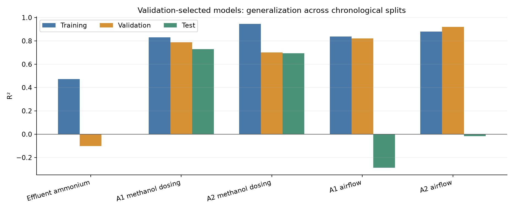
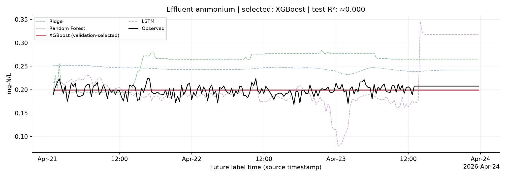
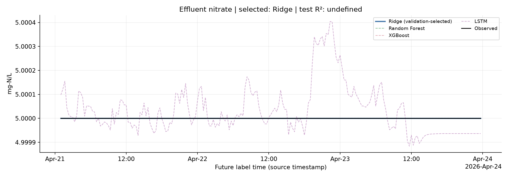
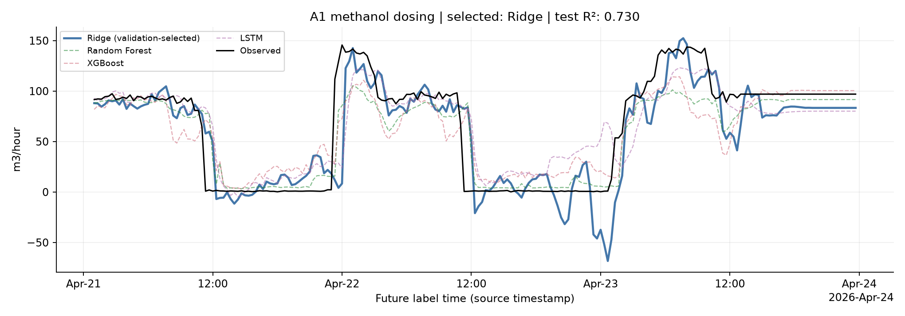
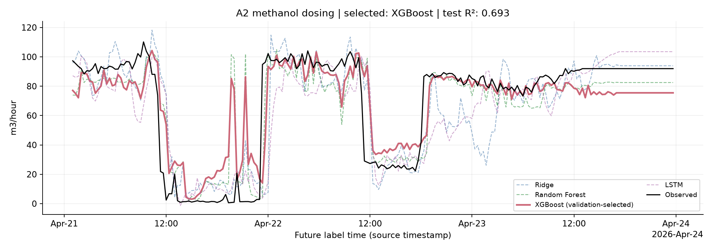
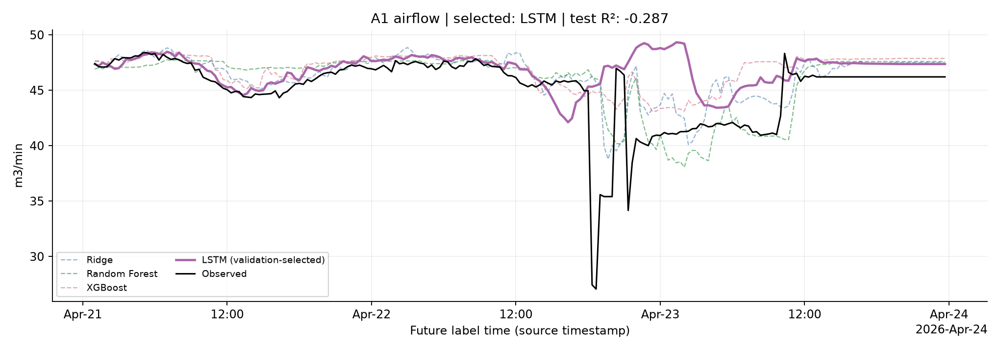
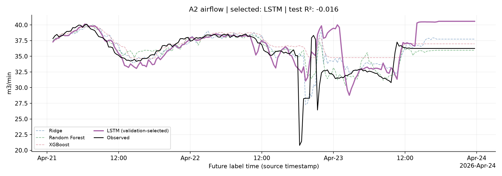

# Multivariate Forecast Results and Discussion — Presentation Content

This revision reports the saved **expanded-history and tuned CSV experiments**. It supersedes the earlier seven-day SQL experiment narrative. Notebook 03–05 figures and persistence percentages belong to the older experiment and must not be reused as evidence for these results. No models were retrained to prepare this report.

## Slide 1 — Study design and chronological evaluation

- Real treatment-plant operating data: **24 March 2026 13:00–23 April 2026 23:59**.
- Training: available March 24–April 17 history. Validation: **April 18–20**. Fixed rolling test: **April 21–23**.
- Predict the **exact observed minute value one hour after each origin**, with origins spaced 20 minutes apart.
- Twelve input samples at 20-minute spacing span **3 hours 40 minutes** and end at the forecast origin.
- Algorithms: **Ridge, Random Forest, XGBoost and LSTM**.

**Speaker notes:** “Future labels crossing training or validation boundaries were purged. Filled estimates cannot become future labels. Test observations may enter later histories once available, as in rolling operation. Time stamps retain the source's timezone-naive representation. This is not a forecast of the whole test period made at its start.”

## Slide 2 — Preparation, features and hyperparameter selection

- Expanded history uses **notebook 02's sensor-specific preparation policy**, rather than notebook 01's unlimited forward filling.
- Carry-forward age limits: flow **2 min**, chemistry **5 min**, MLSS **15 min**. Longer and leading gaps remain missing.
- Workbook checkmarked sensor inputs plus historical target values. Constant/unobserved/unsupported training inputs are excluded.
- Remaining imputation and scaling fit training only; models receive missingness channels.
- Tune using **April 18–20 validation MSE**. On fixed nonconstant labels this also maximizes R². Existing fitted models remain candidates; no combined training/validation refit is performed.
- Final algorithm selection also uses validation error, **not test rankings**.

**Speaker notes:** “Raw operating changes are preserved. Large values alone do not identify sensor faults. Airflow target mappings follow the confirmed headings: A1 = Q_A1_air and A2 = Q_A2_air. Test inputs, masks, origins and labels match the earlier experiment. The latest runs have no persistence baseline, so we do not claim improvement over persistence.”

## Slide 3 — Overall results: validation-selected models

| Target | Validation-selected model | Training R² | Validation R² | Test R² |
|---|---|---:|---:|---:|
| Effluent ammonium | XGBoost | 0.472 | -0.101 | ≈0.000 |
| Effluent nitrate | Ridge | undefined | undefined | undefined |
| A1 methanol dosing | Ridge | 0.831 | 0.788 | 0.730 |
| A2 methanol dosing | XGBoost | 0.945 | 0.701 | 0.693 |
| A1 airflow | LSTM | 0.838 | 0.821 | -0.287 |
| A2 airflow | LSTM | 0.879 | 0.921 | -0.016 |

**Discussion:** “Methanol forecasts retain positive R² on the fixed test period. Airflow validation scores do not transfer to the later operating period. Ammonium test R² is approximately zero. Tuning improved or matched each algorithm's validation error, but did not consistently improve test performance.”

Training R² is in-sample fit. Negative test R² means greater squared error than the retrospective test-set mean reference. Nitrate R² is undefined because its recorded signal is constant. R² does not establish acceptability against a plant-specific error threshold.

## Graph slide layout

Use the test figure in the upper two-thirds with the selected-model callout beneath. Black is observed; the validation-selected algorithm is emphasized and the other tuned algorithms are dashed. The x-axis is future label time. All algorithms use the same observed labels within a target. Do not select a different headline model because its test score is higher.

## Slide 4 — Effluent Ammonium Forecast

**Validation-selected model: XGBoost.** Test N = **211**; MAE **0.009132**; RMSE **0.011110 mg-N/L**; R² **≈0.000**.

- The selected XGBoost model has test R² approximately zero. Small absolute error within this narrow test range does not establish reliable forecasting of concentration changes.
- Training includes values up to 7.652 mg-N/L, while validation and test maxima are below 0.225 mg-N/L. These represent reported real operating variability and are preserved; the discrepancy should be evaluated across operating conditions.

**Speaker note:** “Use the measured name ammonium / NH4-N. The task eff_nh3_n predicts Eff_NH4_N.”

## Slide 5 — Effluent Nitrate Forecast

**Validation-selected model: Ridge.** Test N = **211**; MAE **0.000000**; RMSE **0.000000 mg-N/L**; R² **undefined**.

- The recorded target remains constant at 5.0 mg-N/L. Ridge and tree models have zero error; LSTM can deviate from the constant signal.
- R² is undefined. This experiment cannot establish the ability to forecast nitrate changes.

**Speaker note:** “A constant recorded value is a limitation of this evaluation, not sufficient evidence of a sensor fault.”

## Slide 6 — A1 Methanol Dosing Forecast

**Validation-selected model: Ridge.** Test N = **213**; MAE **17.871515**; RMSE **26.470019 m3/hour**; R² **0.730**.

- Ridge is selected by validation error and retains positive test R², but predicts negative flow during some low-flow periods. Those predictions are shown without clipping and limit physical plausibility.
- Tuned Random Forest has a higher retrospective test R² (0.793), but is not substituted as the headline model after seeing the test result.

**Speaker note:** “Recorded dosing is forecast; optimal chemical doses and chemical savings were not evaluated.”

## Slide 7 — A2 Methanol Dosing Forecast

**Validation-selected model: XGBoost.** Test N = **213**; MAE **13.529343**; RMSE **19.716478 m3/hour**; R² **0.693**.

- Validation selects XGBoost. Test R² remains positive, supporting partial predictability of the recorded dosing pattern.
- XGBoost validation R² increased from 0.682 to 0.701, while test R² decreased from 0.705 to 0.693. Improved validation fit does not guarantee improved later forecasts.

**Speaker note:** “Recorded dosing is forecast; optimal chemical doses and chemical savings were not evaluated.”

## Slide 8 — A1 Aeration Airflow Forecast

**Validation-selected model: LSTM.** Test N = **211**; MAE **2.025027**; RMSE **3.646666 m3/min**; R² **-0.287**.

- Validation selects LSTM, with validation R² 0.821 but negative test R². The validation-to-test gap limits operational confidence.
- Tuned Ridge achieves positive test R² (0.240), but choosing it from that test result would be retrospective selection. Validate algorithm choice across additional chronological periods.

**Speaker note:** “Airflow forecasts describe recorded flow, not optimized aeration setpoints or energy savings.”

## Slide 9 — A2 Aeration Airflow Forecast

**Validation-selected model: LSTM.** Test N = **211**; MAE **1.899255**; RMSE **2.971203 m3/min**; R² **-0.016**.

- Tuned LSTM has validation R² 0.921, but test R² is slightly negative. High validation fit does not establish operational reliability.
- Tuned Random Forest has test R² 0.492. This descriptive comparison motivates broader chronological evaluation rather than replacing the selected algorithm based on the same test.

**Speaker note:** “Airflow forecasts describe recorded flow, not optimized aeration setpoints or energy savings.”

## Slide 10 — Conclusions and next evaluation

- The approach is reportable as an **experimental multivariate time-series forecasting study using real plant operating data**.
- Methanol forecasts generalize more consistently in this period. Ammonium and airflow remain sensitive to the evaluated operating periods.
- More historical data benefited several candidates. Wider hyperparameter tuning did not consistently improve unseen-period performance.
- Preserve real transitions and unusual events. Exclude or correct observations only with independent evidence of measurement faults.
- Add persistence on the same labels, use multiple chronological validation windows, and confirm the frozen procedure on a new later operating period.

**Closing statement:** “These results demonstrate target-dependent forecasting performance under real operational variability. They support continued validation and model development, but do not yet establish a dependable plant-control system or chemical and energy savings.”

The fixed test was excluded from automated parameter/algorithm selection, but has been repeatedly inspected during development. Later independent evaluation is needed. Flow units are inherited from the workbook and require instrument-scaling confirmation. MAE/RMSE remain in target units; percentage improvement over persistence is unavailable for the latest runs.

## Evidence and reproduction

- [General results notebook](../notebooks/06_multivariate_forecast_results.ipynb): executed tables, all algorithm comparisons, target distributions and test plots; no retraining.
- [Headline metrics](assets/current_forecasts/headline_metrics.csv): validation-selected models with training, validation and test R².
- [All experiment metrics](assets/current_forecasts/experiment_metrics.csv): short-history, expanded-history and tuned runs, all algorithms and splits.
- [Validation-selected experiment comparison](assets/current_forecasts/validation_selected_experiment_comparison.csv): comparisons use independently validation-selected models within each experiment.
- [Feature configuration](assets/current_forecasts/feature_configuration.json) and [selected parameters](assets/current_forecasts/selected_parameters.json).
- [Source and snapshot hashes](assets/current_forecasts/provenance.json); [saved-model/split verification](assets/current_forecasts/verification.json).
- Training implementation and reproduction commands: [training README](../src/training/README.md).

Figures in `assets/current_forecasts` are generated from the saved test predictions by the results notebook. Historical figures in `assets/forecast_slides` and metrics in `assets/etl_report` belong to older experiments and remain separate.
