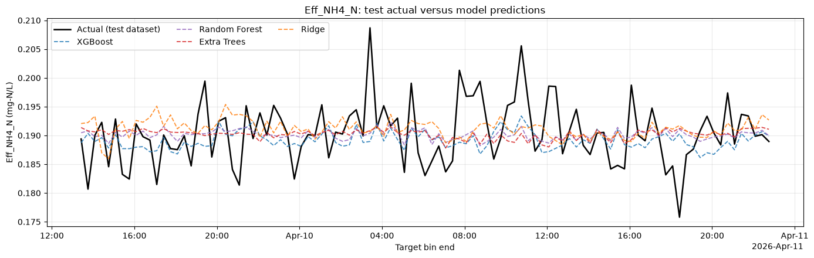
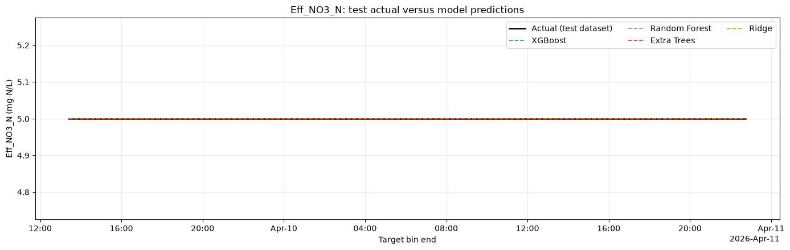
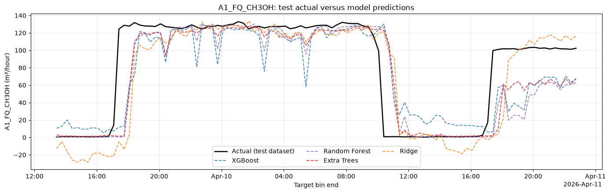
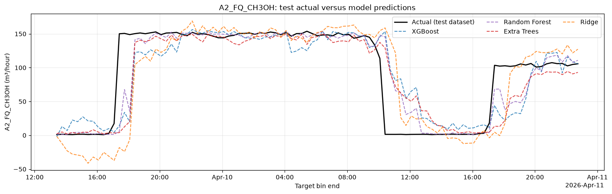
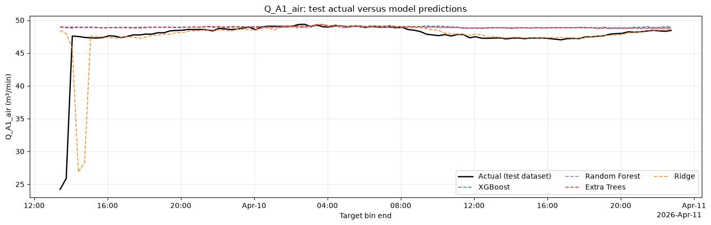
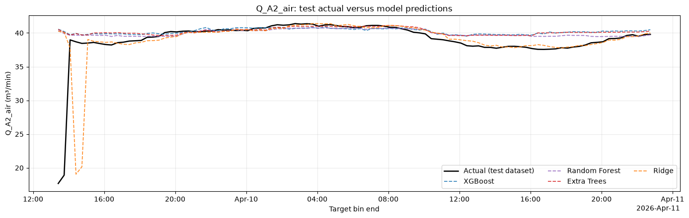

# Forecast Results and Discussion — Presentation Content

Seven slides: one evaluation setup slide, followed by one graph slide for each of six targets. These use the saved **seven-day SQL experiments in notebooks 03–05**. Notebook 02's one-day Drive experiment is separate. No training was rerun to prepare this material.

## Slide 1 — Forecast Evaluation Setup

**Data and split**

- Seven-day source window: **3 April 22:45–10 April 22:45, 2026**, end exclusive.
- **504 observed-only 20-minute averages** produce **501 one-hour input/target pairs**.
- Initial chronological split: **80% earlier origins / 20% later origins**.
- Final counts per target: **398 training / 2 purged / 101 test forecasts**.
- Predict the 20-minute target mean ending **one hour after each forecast origin**.

**Algorithms**

**XGBoost · Random Forest · Extra Trees · Ridge regression**

Reference: **persistence**, which predicts that the future target equals the current measured target.

**Evaluation metrics**

| Metric | Interpretation |
|---|---|
| MAE | Average absolute error; lower is better. |
| RMSE | Gives greater weight to large errors; lower is better. |
| R² | Squared-error performance relative to the retrospective test-set mean; higher is better. |
| Bias | Average prediction minus observation; positive means overprediction, negative means underprediction. |
| Improvement over persistence (%) | Positive values mean lower MAE or RMSE than persistence. |

**Speaker notes:** “The models were trained using earlier observations and evaluated on later observations. Two boundary origins were removed because their future outcomes would not be available when testing began. Each model was evaluated on the same 101 test targets within its task, with fixed parameters and no test-set hyperparameter tuning.”

Training origins run from **3 April 23:05 to 9 April 11:25**. Test origins run from **9 April 12:25 to 10 April 21:45**, and the corresponding test target bins end from **9 April 13:25 to 10 April 22:45**. Times refer to 2026 and retain database timestamps. A training label available exactly at the first test origin is permitted.

Ridge scaling is fitted on training data only. MAE, RMSE and bias retain the target's units. Negative R² means greater squared error than the test-set mean reference; a model can improve on persistence while retaining negative R². Baseline improvement is `100 × (1 − model error / persistence error)`.

## Layout for the six graph slides

Place the saved test-only chart across the upper two-thirds of each slide. Below it, show a short metric callout and two discussion bullets. The black line is actual test data; dashed colored lines are the four learning models. **Persistence appears in the metric comparisons, but is not drawn in these saved charts.** The horizontal axis is the future target bin-end time.

## Slide 2 — Effluent Ammonium Forecast

**Metric callout:** Random Forest — **MAE 0.004053; RMSE 0.005405 mg-N/L; R² −0.016**.

- Random Forest reduced MAE by **29.33%** and RMSE by **25.43%** relative to persistence.
- Predictions stay near the central concentration and miss many observed peaks and troughs.

**Discussion:** “Random Forest achieved the lowest errors on this holdout. However, the graph shows that the models smooth much of the observed variability. All fitted models retain negative R², so improvement over persistence does not establish reliable prediction of concentration changes across operating conditions.”

Use the measured label **ammonium / NH4-N**. The code's `eff_nh3_n` task uses `Eff_NH4_N` as its target.

## Slide 3 — Effluent Nitrate Forecast

**Metric callout:** All methods, including persistence — **MAE 0; RMSE 0; R² undefined**.

- The recorded target remains constant at **5.0 mg-N/L** in this selected dataset.
- Actual and predicted lines overlap; the experiment cannot evaluate forecasting of nitrate changes.

**Discussion:** “The overlapping lines arise from a constant target. Persistence also achieves zero error. Further evaluation requires checking the recorded nitrate signal and obtaining data with meaningful variation. Percentage improvement over persistence is undefined because its error is zero.”

## Slide 4 — A1 Methanol Dosing Forecast

**Metric callout:** Persistence — **MAE 11.7117; RMSE 33.3158 m³/hour**. Best fitted method, Extra Trees — **MAE 18.3306; RMSE 33.6306 m³/hour**.

- Persistence achieved lower MAE and RMSE than all four learning models.
- The graph shows delayed responses to major flow changes; several models underestimate the later restart level.

**Discussion:** “The learned forecasts capture parts of the dosing pattern but struggle around abrupt changes. The positive R² values do not establish an improvement over persistence. Ridge also produces negative flow predictions in low-flow periods, which calls for evaluating physical plausibility alongside error metrics.”

## Slide 5 — A2 Methanol Dosing Forecast

**Metric callout:** Random Forest — **MAE 14.8596; RMSE 31.9198 m³/hour; R² 0.761**. Persistence — **MAE 13.2107; RMSE 37.4613 m³/hour**.

- Random Forest reduced RMSE by **14.79%**, but increased MAE by **12.48%** versus persistence.
- Models broadly reproduce the high-flow period while showing timing and magnitude errors around shutdown and restart transitions.

**Discussion:** “Random Forest is preferable on RMSE, while persistence is preferable on MAE. Selecting a model therefore requires an agreed error criterion. The graph also shows negative Ridge predictions during low-flow periods.”

Both methanol experiments forecast recorded dosing flow; they do not establish optimal doses or chemical savings. Units follow workbook labels and require instrument-scaling confirmation.

## Slide 6 — A1 Aeration Airflow Forecast

**Metric callout:** Ridge — **MAE 1.0651 m³/min**. Random Forest — **RMSE 3.5063 m³/min**. Persistence — **MAE 1.1147; RMSE 4.5548 m³/min**.

- Ridge improved MAE by **4.46%**; Random Forest improved RMSE by **23.02%** versus persistence.
- Tree-model predictions remain relatively flat, missing the early low readings and some gradual changes. Ridge follows more of the later variation.

**Discussion:** “The lowest-error model depends on the metric. Random Forest has lower RMSE but higher MAE than persistence. All fitted methods have negative R² on this holdout, so operational accuracy requires further evaluation.”

## Slide 7 — A2 Aeration Airflow Forecast

**Metric callout:** Ridge — **MAE 1.1208 m³/min**. Random Forest — **RMSE 3.2216 m³/min**. Persistence — **MAE 1.1577; RMSE 4.2189 m³/min**.

- Ridge improved MAE by **3.19%**; Random Forest improved RMSE by **23.64%** versus persistence.
- Tree models miss the early low values and overpredict part of the later lower-flow period. Ridge tracks more of the gradual change but shows an early timing mismatch.

**Discussion:** “As with A1, Ridge performs best on MAE and Random Forest on RMSE. All R² values remain negative, including Random Forest at approximately −0.018. We need evaluation across additional operating periods before selecting a model.”

Airflow forecasts describe recorded flow, with workbook units of m³/min pending instrument-scaling confirmation. The experiments do not evaluate optimized aeration setpoints or energy savings.

## Transition to the conclusion

“The experiments demonstrate target-specific improvements rather than one consistently superior algorithm. The next step is to choose the operational error criterion and validate candidates on independent later data with more varied operating conditions.”

## Evidence

- Source notebooks: [03: effluent](../notebooks/03_train_effluent_nh3_no3.ipynb), [04: methanol](../notebooks/04_train_ch3oh_dosing.ipynb), [05: airflow](../notebooks/05_train_aeration_flow.ipynb).
- [Full metric table](assets/etl_report/evaluation_metrics.csv): use **N = 101** for these slides; **N = 14** belongs to the separate Drive experiment.
- [Figure provenance](assets/forecast_slides/provenance.json): saved notebook hashes and output locations. Charts were extracted directly without modifying the plotted data.
